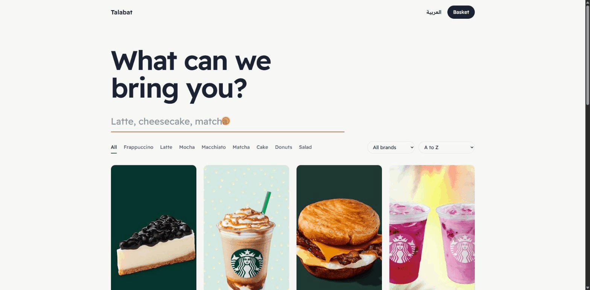

# Talabat API

[](https://github.com/AhmeddAymannHalim/LinkDev.Talabat/actions/workflows/ci.yml)

An e-commerce REST API for a café delivery service, built with **ASP.NET Core 8** and **Clean Architecture**, with a bilingual (English / Arabic, RTL) storefront.

     

## Highlights

- **8-project Clean Architecture solution** (Domain, Application, Application.Abstraction, Persistence, Infrastructure, Controllers, API host, Tests).
- **Two SQL Server databases**: one for the store (products, orders) and one for ASP.NET Core Identity, each with its own DbContext, migrations and seeding.
- **Redis shopping basket** with a configurable time-to-live, so guests can shop without an account.
- **Secure ordering**: prices always come from the database, never from the client; each user can only see their own orders.
- **JWT authentication** with ASP.NET Core Identity, account lockout and saved shipping addresses.
- **57 automated tests**: 44 unit tests (xUnit + Moq) and 13 end-to-end integration tests against a real SQL Server and Redis, run by **GitHub Actions** on every push.
- **Bilingual storefront** (English / Arabic RTL) plus a **live demo on GitHub Pages**, a 26-request **Postman** collection and Swagger.

## Tech stack

| Area | Technology |
|---|---|
| Backend | ASP.NET Core 8 Web API, C# 12 |
| Data | Entity Framework Core 8 (SQL Server, lazy-loading proxies, interceptors), LINQ |
| Cache / basket | Redis (StackExchange.Redis) |
| Security | ASP.NET Core Identity, JWT bearer tokens, user-secrets |
| Mapping | AutoMapper (custom value resolvers for picture URLs) |
| Patterns | Clean Architecture, Specification, Generic Repository, Unit of Work, Service Manager (lazy services), Dependency Injection |
| API docs | Swagger / OpenAPI, Postman + Newman |
| Testing | xUnit, Moq, WebApplicationFactory integration tests |
| DevOps | GitHub Actions CI (SQL Server and Redis service containers), GitHub Pages deployment |
| Front end | HTML, CSS, vanilla JavaScript, i18n (EN / AR, RTL) |

## ▶ Live demo

**[Open the demo: ahmeddaymannhalim.github.io/LinkDev.Talabat](https://ahmeddaymannhalim.github.io/LinkDev.Talabat/)**

No install, no sign-up. Try the whole shop in about a minute:

1. **Browse** the menu. Search ("cake"), filter by category or brand, and sort by price.
2. **Create an account** with *Sign in*. Any email works. The password needs 6 to 10 characters with an upper-case letter, a lower-case letter, a number and a symbol, for example `P@ssw0rd!`.
3. **Add items** to the basket and open it.
4. Press **Checkout**, fill in an address, pick a delivery method and **place the order**.
5. Open **My orders** to see it. Switch to **العربية** at any time for Arabic with right-to-left layout.

> The hosted demo runs entirely in your browser with sample data, so it needs no server. Everything you create stays in your browser and is never uploaded. It behaves like the real API (same validation, errors and totals), which you can run yourself below.



## Run the real API

You need the **.NET 8 SDK**, **SQL Server** (Express is fine) and **Redis**.

```bash
git clone https://github.com/AhmeddAymannHalim/LinkDev.Talabat.git
cd LinkDev.Talabat

# 1. Redis (any Redis works; this is the quickest with Docker)
docker run -d --name talabat-redis -p 6379:6379 redis:7-alpine

# 2. The JWT signing key (kept out of the repo on purpose)
cd LinkDev.Talabat.APIs
dotnet user-secrets set "JwtSettings:Key" "<any random secret of 64+ characters>"

# 3. Run. The databases are created, migrated and seeded on first start.
dotnet run
```

Then open the address printed in the console:

| Where | What |
|---|---|
| `/store/` | The storefront, talking to the real API |
| `/swagger` | Interactive API documentation |

SQL Server connection strings are in `LinkDev.Talabat.APIs/appsettings.json` and default to `.\SQLEXPRESS`. Change `Server=` if your instance is different.

Optional: `dotnet user-secrets set "Seed:DemoUserPassword" "<password>"` seeds a demo user. Without it you simply register through the API or the storefront.

## Use the API

| I want to... | Go to |
|---|---|
| Follow a **step-by-step walkthrough** (register, sign in, basket, order) with copy-paste commands | [`docs/API-GUIDE.md`](docs/API-GUIDE.md) |
| Click through every endpoint in the browser | `/swagger` (click *Authorize* and paste a token from `login`) |
| Call it from **Postman** | Import both files in [`docs/postman`](docs/postman), pick *Talabat - Local*, set `baseUrl`, press *Run* |
| Run the Postman checks from the command line | `npx newman run docs/postman/Talabat.postman_collection.json -e docs/postman/Talabat-Local.postman_environment.json --env-var baseUrl=http://localhost:5086` |

The Postman collection has 26 requests and 42 assertions. Register and Login save the token automatically, and later requests reuse the product, basket and order ids.

### Main endpoints

| Area | Endpoint |
|---|---|
| Account | `POST /api/account/register`, `POST /api/account/login`, `GET /api/account`, `GET/PUT /api/account/address`, `GET /api/account/emailexists` |
| Products | `GET /api/products` (`search`, `sort`, `brandId`, `categoryId`, `pageIndex`, `pageSize`), `GET /api/products/{id}`, `GET /api/products/brands`, `GET /api/products/categories` |
| Basket | `GET/POST/DELETE /api/basket` |
| Orders (sign in required) | `POST/GET /api/orders`, `GET /api/orders/{id}`, `GET /api/orders/deliveryMethods` |

## Features

- **Clean Architecture**: Domain, Application, Infrastructure and API layers with one-way dependencies.
- **Catalog**: brands, categories, search, sorting and pagination, built on the Specification pattern.
- **Basket**: stored in **Redis** with a configurable time-to-live. Guests can shop without an account.
- **Orders**: totals are always computed from database prices, never from client input, and each customer sees only their own orders.
- **Authentication**: ASP.NET Core Identity with **JWT** bearer tokens (issuer, audience, lifetime and signing-key validation), unique emails, account lockout after repeated failed logins, an email-availability check and saved addresses.
- **Persistence**: EF Core with SQL Server, Generic Repository + Unit of Work, Fluent API configurations, and an audit interceptor (created / modified by and on).
- **Two databases**: the store and Identity live in separate databases with separate DbContexts, migrations and initializers. Products, brands, categories and delivery methods are seeded from JSON on first start.
- **Service layer**: a Service Manager creates each service lazily, only when a request needs it. AutoMapper value resolvers turn stored picture paths into full URLs.
- **Cross-cutting**: global exception middleware with a uniform error shape (400 / 401 / 404 / 500), structured validation errors, a status-code fallback for unknown routes, Swagger, automatic migration and seeding at startup.
- **Storefront**: plain HTML, CSS and JavaScript served by the API at `/store/`: search, filters, basket, sign in and register, checkout, order history, English and Arabic (RTL).

## Architecture

```
APIs ----------> APIs.Controllers
  |                   |
  v                   v
Core.Application ---> Core.Application.Abstraction (DTOs, service contracts)
  |
  v
Core.Domain (entities, specifications, repository contracts)
  ^
  |
Infrastructure.Presistence (EF Core, repositories, seeding)    Infrastructure (Redis basket)
```

| Project | Responsibility |
|---|---|
| `LinkDev.Talabat.Core.Domain` | Entities, specifications and repository contracts |
| `LinkDev.Talabat.Core.Application.Abstraction` | DTOs and service interfaces |
| `LinkDev.Talabat.Core.Application` | Business logic, mapping and exceptions |
| `LinkDev.Talabat.Infrastructure.Presistence` | DbContexts, migrations, repositories and seeding |
| `LinkDev.Talabat.Infrastructure` | Redis basket repository |
| `LinkDev.Talabat.APIs.Controllers` | API controllers |
| `LinkDev.Talabat.APIs` | Startup project: Program, middleware, DI and the storefront (`wwwroot/store`) |
| `LinkDev.Talabat.Tests` | Unit and integration tests |

## Tests

```bash
dotnet test LinkDev.Talabat.Tests
```

- **57 tests in total.**
- **Unit tests** (44, xUnit and Moq) cover the basket, order, product, employee and auth services and the registration password rule, and need nothing external.
- **Integration tests** (13) start the real API against throw-away SQL Server databases and a real Redis. They read `TALABAT_TEST_SQL` (a SQL Server connection string without a database) and `TALABAT_TEST_REDIS` (`host:port`), defaulting to local SQL Server Express and `localhost:6379`. If a server isn't reachable they are skipped, not failed.
- **CI** builds and runs everything with SQL Server and Redis service containers on every push, and fails the build on known high-severity package vulnerabilities (`NU1903`).
- **CD**: a second workflow publishes the storefront demo to GitHub Pages whenever it changes.

## About this version

The project started as a course project (LinkDev ASP.NET Core track). This version is an upgrade of it, applying what I learned from more than a year of professional ASP.NET Core work.

**Security**
- The JWT signing key moved out of source control into user-secrets, and the app fails fast with a clear message if it is missing.
- Removed the hard-coded seed user and password. A demo user is only created when a password is supplied through configuration.
- Upgraded AutoMapper to a release that fixes a known high-severity advisory, and aligned mixed IdentityModel package versions.

**Correctness (found by tests and by running the real API)**
- Product search never matched most products because `NormalizedName` was never populated by the seeder.
- Orders could be created from an empty basket, with an unknown delivery method, or with a product that no longer exists. Each now returns a proper 400 or 404.
- Looking up a missing basket never reported "not found" (wrong variable in the null check).
- A missing employee was mapped instead of returning 404.
- `pageSize=0` or a negative `pageIndex` are now clamped to valid values.
- Registering an existing email returned only "Bad Request"; it now says which email or username is taken.
- The password rule had HTML entities (`&amp;`, `&quot;`) pasted into its regex, so letters like `a` or `t` counted as symbols while real symbols like `<`, `>` and `"` were rejected. It now matches the documented rule and is covered by tests.
- Unhandled exceptions are now always logged, and seeding no longer depends on the working directory or file name casing.

**Quality and product**
- Unit and end-to-end integration tests, and a GitHub Actions pipeline with SQL Server and Redis service containers.
- A storefront with accounts, checkout and order history, a hosted in-browser demo, a Postman collection and an API guide.

## Roadmap
- Payment integration.
- Admin area for managing products and orders (needs admin-only endpoints first).
- Hosting the API itself for a live backend demo (see [`docs/DEPLOY.md`](docs/DEPLOY.md)).

## License and disclaimer

The source code is released under the [MIT License](LICENSE).

This is a personal portfolio project. It is not affiliated with, endorsed by, or connected to Talabat or any of the brands that appear in the sample data. Product names, brand names and the sample product photos in `LinkDev.Talabat.APIs/wwwroot/images` belong to their respective owners and are used here only to demonstrate the application. They are not covered by the MIT License.
